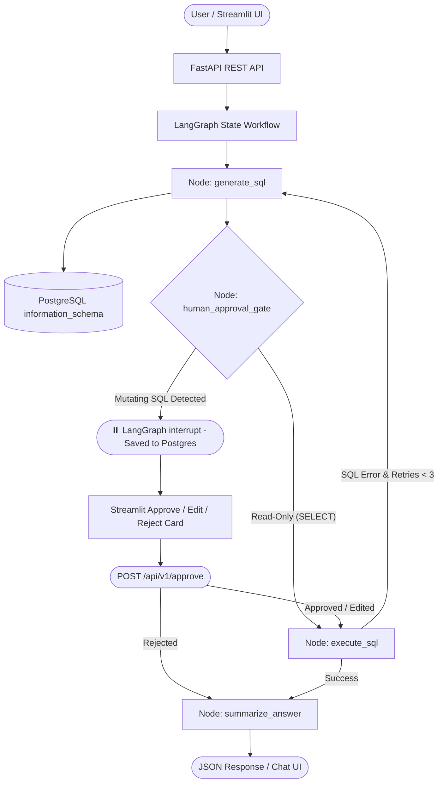

# 🛡️ SentinelSQL

**Autonomous Text-to-SQL Orchestration Engine with Self-Healing Execution Loops & Human-in-the-Loop (HITL) Guardrails.**

Built with **LangGraph**, **FastAPI**, **PostgreSQL (`AsyncPostgresSaver`)**, **Streamlit**, and **Python Virtual Environments**.

---

## 🌟 Why SentinelSQL?

Standard LLM Text-to-SQL wrappers fail in production for two reasons:
1. **Hallucinated Schemas & Syntax Errors:** A single broken table reference or invalid JOIN crashes the pipeline.
2. **Unchecked Destructive Queries:** Prompt injection or LLM misfires can execute unintended `DELETE`, `DROP`, or `UPDATE` statements against production tables.

**SentinelSQL** solves both using a stateful cyclic graph architecture:
* **Dynamic Database Introspection:** Introspects live PostgreSQL `information_schema` at runtime to feed accurate table structures to the LLM (while automatically filtering out internal checkpointer state tables).
* **Self-Correcting Reflection Loop:** Captures runtime PostgreSQL exceptions (`psycopg` errors) via conditional graph edges and routes state back to the generator node for automatic syntax repair.
* **Dual-Layer HITL Mutation Guardrails:** Combines Pydantic structured outputs, regex AST inspection, and LangGraph `interrupt()` primitives to pause execution and require explicit admin approval before executing state-mutating queries.
* **Persistent Checkpointing:** Backed by `AsyncPostgresSaver` and async connection pooling, ensuring conversation threads and state survive restarts or container scaling.

---

## 🏗️ System Architecture

